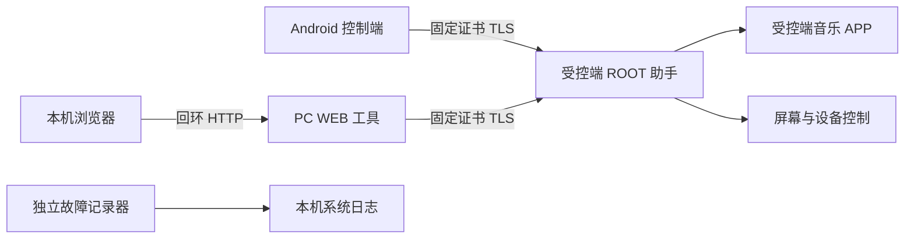

# 代码结构与信任边界

## 运行结构

控制端和受控端共用 APK，但运行职责不同。控制端不需要 ROOT；受控端通过 ROOT 安装并运行助手。PC 浏览器不直接取得设备控制凭据，由本机工具代发请求。故障记录器有独立包名、ROOT 授权、启停和数据目录。

## 主要模块

| 代码 | 职责 |
| --- | --- |
| MainActivity | 两种模式的原生界面、生命周期和交互；当前仍较大，后续拆分需保持行为 |
| DeviceClient、SavedDevices、LanAddress | 固定证书连接、设备档案与地址变化 |
| Pairing、Controllers、CertificateMaker | 临时配对、本机批准、独立凭据与证书 |
| ReceiverRuntime、ResidentService、guardian.sh | ROOT 助手安装、启动与存活管理 |
| ReceiverServer | 请求鉴权、操作分发与手机电源策略；目前仍包含较多设备逻辑 |
| HdmiDisplay、PhysicalInputMonitor、KeyBinding | 盒子显示接口与本机按键 |
| MediaActions、QuickPlayState | 媒体会话控制与播放确认 |
| QuickPlayService、QuickPlayWidget、QuickPlayTile | 控制端快捷入口 |
| tools/web-debug-toolkit.py、work/player-control/index.html | PC 本机代理与浏览器界面 |

## 权限边界

远程控制只能使用明确提供的日常动作。配置、安全管理、按键工具和服务管理要求受控端本机管理凭据及回环连接。配对凭据按控制设备独立签发，可撤销。

完整屏幕操作仍可能进入系统设置，因此这不是受限屏幕沙箱。ROOT 助手的本机权限、系统固件和第三方音乐 APP 不在 TLS 本身的保护范围内。详见 [安全说明](home-network-security.md)。

## 验证边界

统一检查入口运行纯逻辑、模拟媒体会话、网页行为及真实回环 HTTP／TLS 测试，不连接实际受控设备。部分 Java 测试抽取生产方法组成独立探针，因此并不覆盖整个 Android 生命周期；新增模块应尽量直接测试纯逻辑类。

Android 构建与实机验收独立。当前使用直接 SDK 工具构建，尚未迁移到 Gradle，也没有自动更新、跨平台构建或完整 Android 界面测试。
